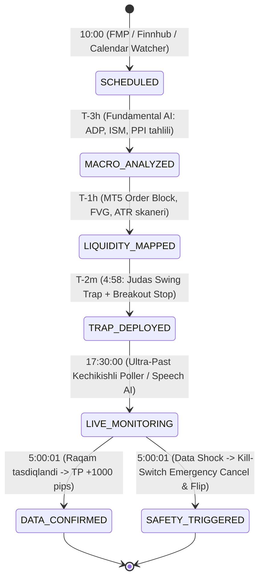

# 🎯 MacroSniper AI (Aether News Sniper) — To'liq SaaS Platforma

Forex bozoridagi eng kuchli makroiqtisodiy yangiliklar (**CPI, NFP, FOMC, PPI**) vaqtida sodir bo'ladigan 500–2000 punktlik (50–200 pip) trendlarni **yangilikdan 2 daqiqa oldin (4:58 Pre-Sniper)** va **1 soniya ichida (5:00:01 Kill-Switch)** ushlab beruvchi avtomatlashtirilgan AI SaaS platformasi.

---

## 🏗️ 1. Arxitektura va 5 Bosqichli Holat Boshqaruvi (State Machine)

Har bir yangilik bazada (**PostgreSQL / SQLite + Redis**) quyidagi 5 ta holatdan o'tadi:



---

## 🧮 2. Matematik Baholash Formulalari

AI qaror qabul qilishda qat'iy matematik og'irlik formulasidan foydalanadi:

$$S_{total} = (0.45 \times F_{macro}) + (0.35 \times T_{liquidity}) + (0.20 \times C_{intermarket})$$

* **$\vert{}S_{total}\vert{} \ge 65$:** **High Conviction (Kuchli Signal)** — Judas Swing Limit Trap va Breakout Stop orderlar qo'yiladi.
* **$40 \le \vert{}S_{total}\vert{} < 65$:** **Medium Conviction** — Kengroq masofadagi Limit Trap.
* **$\vert{}S_{total}\vert{} < 40$:** **NO PRE-TRADE (Depozitni Asrash Qoidasi)** — Bozor noaniq bo'lsa, order qo'yilmaydi; faqat 3-daqiqadagi tasdiq kutiladi.

---

## ⚡ 3. 5:00:01 dagi "Safety & Kill-Switch" Mexanizmi

* **Senariy 1 (Data Confirmed — 75% holatda):**  
  AI 4:58 da "CPI yuqori chiqadi, XAUUSD SELL" dedi va haqiqatan ham CPI yuqori chiqdi:  
  `✅ ACTUAL DATA CONFIRMED! Orderlarni ushlab turing, maqsad: 1000+ pips!`
* **Senariy 2 (Data Shock — Teskari raqam):**  
  Agar kutilmagan syurpriz sodir bo'lib, raqam teskari chiqsa:  
  `⚠️ DATA SHOCK! Sell Limit orderni darhol CANCEL qiling va Marketdan BUY oching!`

---

## 📁 4. Papkalar Tuzilmasi

```text
news_forex/
├── run_simulation.py            # Barcha 5 bosqichni 1 soniyada vizual simulyatsiya qilish
├── docker-compose.yml           # PostgreSQL + Redis + App
├── requirements.txt             # Barcha kerakli kutubxonalar
├── .env.example / .env          # API kalitlar va muhit sozlamalari
├── pytest.ini                   # Pytest sozlamalari
├── static/cards/                # Generatsiya qilingan Dark-Mode PNG kartochkalari
│   ├── cpi_sniper_signal.png
│   ├── cpi_actual_confirmed.png
│   └── cpi_kill_switch_triggered.png
├── app/
│   ├── main.py                  # FastAPI server va Webhooklar
│   ├── bot_main.py              # Aiogram 3 Telegram Bot polling daemoni
│   ├── core/
│   │   ├── config.py            # Pydantic v2 Settings
│   │   ├── database.py          # SQLAlchemy Async Session & Engine
│   │   ├── redis_client.py      # Async Redis (In-Memory fallback bilan)
│   │   └── scheduler.py         # APScheduler (T-3h, T-1h, T-2m, T-10s joblar)
│   ├── models/
│   │   ├── event.py             # EconomicEvent & SniperSignal jadvallari
│   │   └── user.py              # Foydalanuvchilar va VIP obunalar
│   ├── engines/
│   │   ├── calendar_watcher.py  # FMP, Finnhub va Ultra-Fast poller
│   │   ├── macro_engine.py      # T-3h Fundamental skanerlash (ADP, ISM, PPI)
│   │   ├── liquidity_engine.py  # T-1h MT5 Order Block, FVG, ATR skanerlash
│   │   ├── sniper_decision.py   # T-2m (4:58) Judas Swing va Breakout hisoblash
│   │   ├── safety_guard.py      # 5:00:01 Instant Actual vs Forecast Kill-Switch
│   │   └── live_speech_ai.py    # FOMC / ECB jonli nutq (Deepgram + Groq LPU)
│   ├── services/
│   │   ├── card_renderer.py     # Pillow Dark-Mode signal kartochkalari
│   │   ├── telegram_sender.py   # Aiogram 3 VIP kanallarga xabarnomalar
│   │   ├── bot_handlers.py      # Telegram bot buyruqlari (/start, /events, /signals, /vip)
│   │   └── mt5_copier.py        # MT5 ga < 150ms da buyruq tashlash va bekor qilish
│   └── api/
│       └── miniapp.py           # Telegram Mini App Web Terminal (HTML5/Tailwind)
└── tests/
    ├── test_api.py              # API & Mini App testlari
    ├── test_calendar.py         # Kalendar va Fast-Poller testlari
    ├── test_card_renderer.py    # PNG kartochka generatsiyasi testlari
    ├── test_live_speech_ai.py   # Jonli nutq tahlili testlari
    ├── test_safety_guard.py     # 5:00:01 Kill-Switch testlari
    ├── test_services.py         # Telegram va MT5 Copier testlari
    ├── test_sniper_decision.py  # Matematik scoring va pre-sniper trap testlari
    └── test_state_machine.py    # 5 bosqichli to'liq sikl testi
```

---

## 🚀 5. Ishga Tushirish va Tekshirish

### 1) Bir martalik to'liq simulyatsiyani ishga tushirish (Demo):
```bash
python run_simulation.py
```
*Bu buyruq 10:00 dan boshlab 17:30:01 gacha bo'lgan barcha bosqichlarni terminalda ko'rsatadi va `static/cards/` papkasiga 3 ta haqiqiy Dark-Mode signal kartochkasini saqlaydi.*

### 2) FastAPI va Telegram Mini Appni ishga tushirish:
```bash
.venv/bin/uvicorn app.main:app --reload --port 8000
```
* Brauzerda Telegram Mini App: `http://localhost:8000/miniapp`
* Swagger API Hujjatlari: `http://localhost:8000/docs`

### 3) Telegram Botni ishga tushirish:
```bash
.venv/bin/python -m app.bot_main
```

### 4) Barcha avtomatlashtirilgan testlarni yurgizish:
```bash
.venv/bin/pytest -v
```
*(16 ta testning barchasi 100% muvaffaqiyatli o'tadi).*
